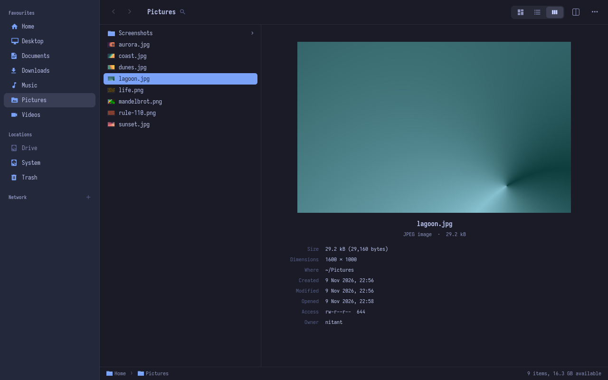
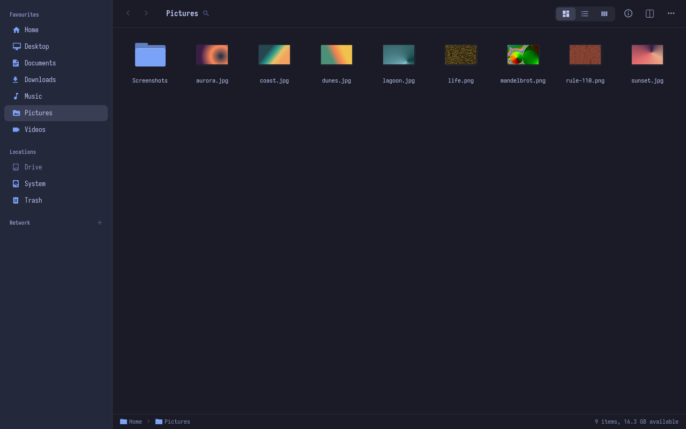
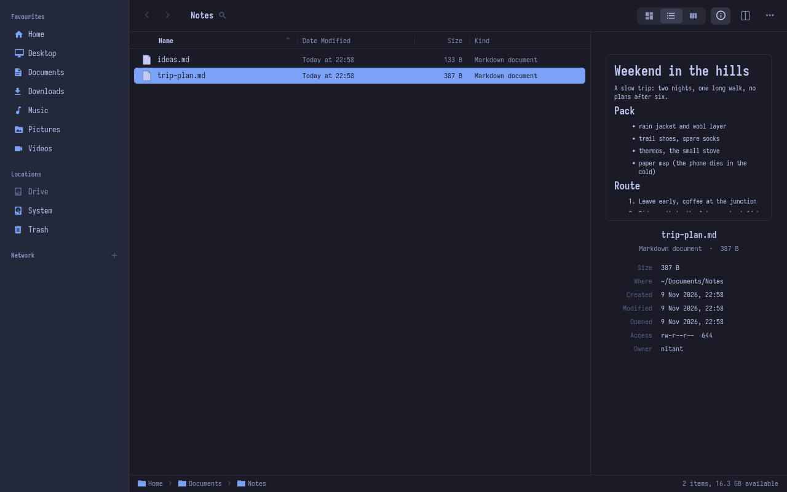
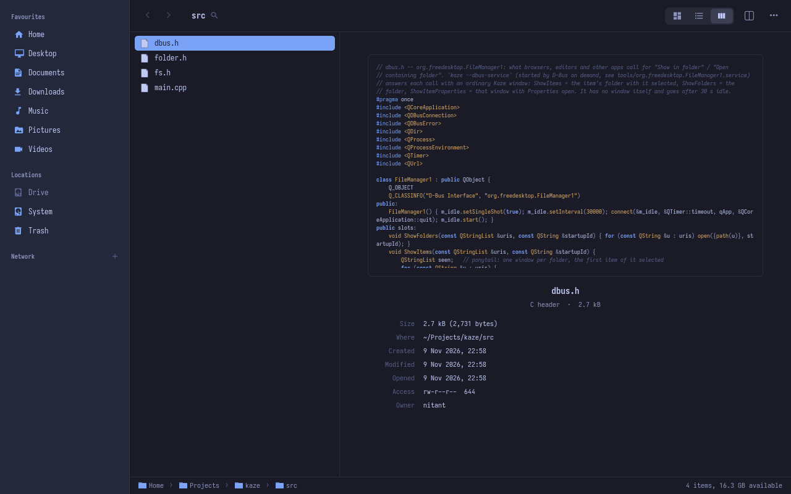
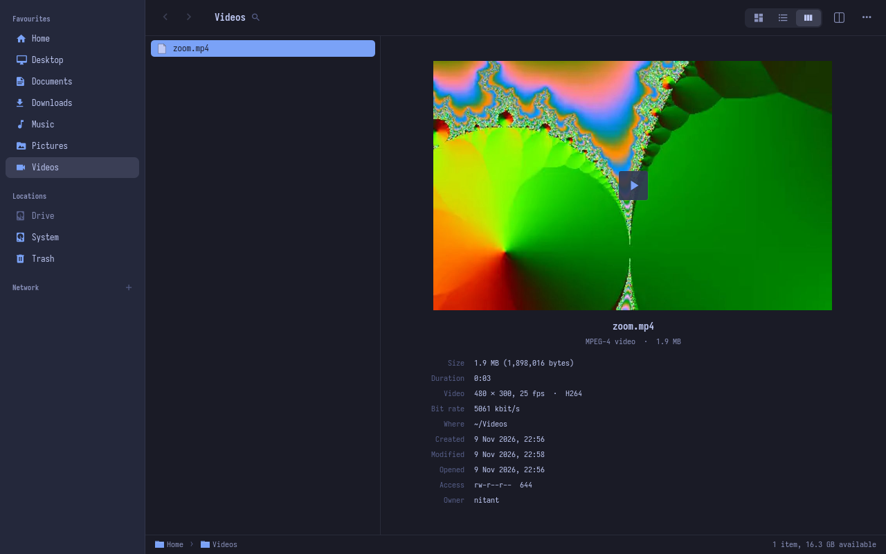
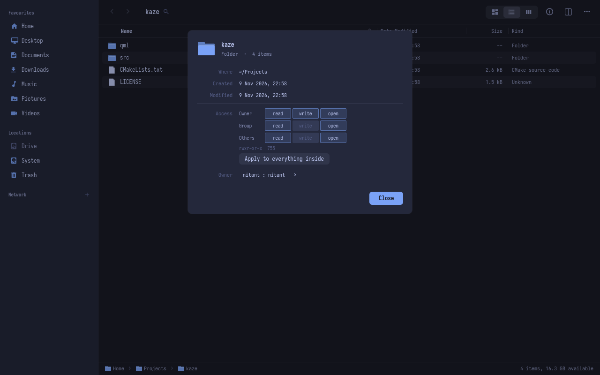
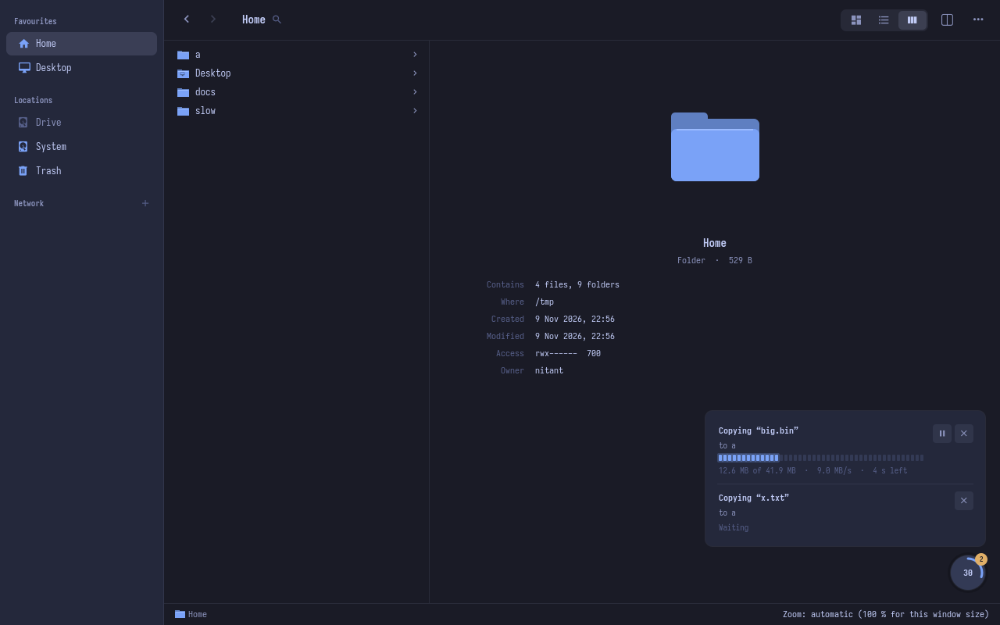
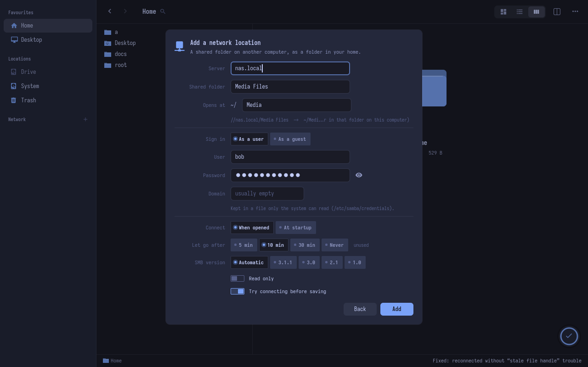
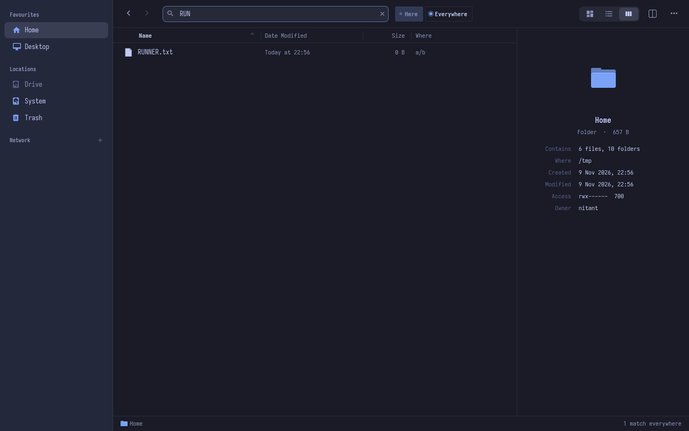

<div align="center">

# Kaze

**A fast, keyboard-friendly file manager for Linux, built with Qt 6 and QML.**

Column, list and icon views · rich previews · undoable file operations · network shares that never freeze the window




</div>

Kaze (風, "wind") is the file manager of [Udiksa](https://github.com/arcje-acrh/Udiksa), a Hyprland desktop for Arch
Linux, but it runs on any Linux desktop. It takes its layout from Finder and Dolphin, and its colours and font from the
Udiksa shell when that is around (with a built-in theme when it is not).

## Contents

- [Features](#features)
- [Screenshots](#screenshots)
- [Install](#install)
- [Usage](#usage)
- [Keyboard shortcuts](#keyboard-shortcuts)
- [Network locations](#network-locations)
- [Configuration and files](#configuration-and-files)
- [How it stays responsive](#how-it-stays-responsive)
- [License](#license)

## Features

**Browsing**
- Three views: **columns** (the folder and its parent plus a large preview), **list** (sortable, resizable columns)
  and **icons**, with an optional details panel (Ctrl+I) in list and icon view.
- **Split view** (F3): two folders side by side, F5 / F6 copy or move across.
- Back / forward history, a clickable path bar, bookmarks shared with GTK apps, hidden files on Ctrl+H.
- **Spring-loaded folders**: hold a dragged file over a folder and it opens.
- Folder **colours and emblems** (right-click › Change Look…), and git status letters on changed files.
- The whole window **zooms as one** (Ctrl + / Ctrl − / Ctrl+scroll), and picks a sensible size from the window.

**Previews**
- Pictures (including camera RAW), PDFs (every page in Quick Look), Office documents (via OnlyOffice's converter),
  EPUB covers, fonts (letters in several sizes), and 3D models when `f3d` is installed.
- **Videos play right in the preview**: a play key, an LED seek bar and the time.
- Code in colour (`source-highlight`, theme colours), Markdown rendered, plain text as is.
- File details: picture size, camera, exposure and date taken; video and audio length, resolution, frame rate, codecs
  and tags; PDF pages and page size.
- **Quick Look** (Space), with the arrow keys still moving through the folder.

**File operations**
- Copy, move, trash, delete, rename, compress and extract as **jobs**: one paste is one job, with progress, speed, time
  left, **pause** and stop. A job that fails stays in the list with the reason.
- **Undo** (Ctrl+Z) for copies, moves, trashing, renames, new files and folders, and permission changes (30 kept).
- **Name conflicts** ask per item or for all: Keep Both, Replace, Skip, or Merge for folders.
- **Closing the window does not stop running jobs**: they finish in the background and a desktop notification says how
  each one ended.
- Drag and drop everywhere (rows, sidebar, path bar, the other pane, other apps). Same drive moves, another drive
  copies, Ctrl copies, Shift moves, Alt asks (move / copy / link).
- **Properties** (right-click › Properties…): read / write / run keys for owner, group and others, applied at once
  (and undoable); a folder can pass them to everything inside. Change the owner, with a password prompt only when needed.
- The Trash covers the home Trash and every mounted drive's own, and puts items back where they came from.

**Search**
- Type in the folder name in the toolbar: names containing every word you type, in this folder and below, results
  streaming in with a Where column.
- **Here | Everywhere** (or Tab): search the whole computer at once from the `plocate` index.

**Archives and disk space**
- Zip, tar.*, 7z, rar and iso **open like folders** (read only); Extract Here makes a real folder.
- **Disk Usage**: what takes the space in a folder, biggest first, with LED bars; click a folder to go in.

**Network shares**
- Add, change and remove SMB shares from Kaze (see [Network locations](#network-locations)). Servers announcing
  themselves nearby are offered.
- A share whose server is not answering is greyed out instead of hanging the window.
- Before copying to a share, Kaze warns about names that differ only in upper / lower case (Windows-style shares
  treat them as one name).

**Desktop integration**
- Becomes the default for opening folders, and answers **"Show in folder"** from browsers, editors and other apps
  (`org.freedesktop.FileManager1`): a normal Kaze window with the file selected.
- Clipboard shared with other file managers; F4 opens a terminal in the folder.

## Screenshots

| | |
|:---:|:---:|
|  |  |
| **Icon view**: thumbnails for pictures, videos and PDFs | **List view** with the details panel: Markdown rendered |
|  |  |
| **Code** in the theme's colours | **Videos** play in the preview |
|  |  |
| **Properties**: permissions and owner | **Jobs**: progress, speed, time left, pause / stop |
|  |  |
| **Network locations**: SMB shares in a few fields | **Search** here or everywhere |

## Install

### Arch Linux (package)

```sh
git clone https://github.com/arcje-acrh/Kaze.git
cd Kaze/pkg
makepkg -si
```

This installs `/usr/bin/kaze`, its desktop entry, and the network-locations helper (`/usr/lib/kaze/kaze-share`).
Remove it with `sudo pacman -R kaze`.

To make Kaze the default file manager and the one that answers "Show in folder":

```sh
xdg-mime default kaze.desktop inode/directory
mkdir -p ~/.local/share/dbus-1/services
cp /usr/share/kaze/org.freedesktop.FileManager1.service ~/.local/share/dbus-1/services/
```

### From source (any distribution)

```sh
cmake -S . -B build -G Ninja -DCMAKE_BUILD_TYPE=Release -DCMAKE_INSTALL_PREFIX=/usr
cmake --build build
sudo cmake --install build
```

### Dependencies

| | Packages (Arch names) |
|---|---|
| **Required** | `qt6-base`, `qt6-declarative`, `qt6-multimedia`, `qt6-multimedia-ffmpeg`, `plocate`, `polkit`, `libarchive` |
| **Build** | `cmake`, `ninja` (or make), a C++20 compiler |
| **Previews** (optional) | `poppler` (PDF), `ffmpegthumbnailer` + `ffmpeg` (video), `libraw` (camera RAW), `exiv2` (photo details), `source-highlight` (code colours), `unzip` (EPUB), `f3d` (3D models), OnlyOffice (Office files) |
| **Network** (optional) | `cifs-utils` (SMB), `avahi` (nearby servers), `udisks2` (drives) |
| **Other** (optional) | `git` (status letters), `zip` / `7zip` (compress / 7z), `libnotify` (notices for jobs finished in the background) |

Anything optional that is missing simply leaves its part out.

## Usage

```
kaze [folder | file]          # a file opens its folder with the file selected
kaze --properties <path>      # opens with that item's Properties sheet
```

Right-click anything for its actions: Open With, cut / copy / paste, rename, compress, extract, copy path, new file
or folder, Disk Usage, Change Look, Properties. In the sidebar, right-click for Open in Other Pane, Open in Terminal,
Eject / Mount, Empty Trash or Disconnect; drop a folder on the Favourites heading to pin it.

## Keyboard shortcuts

| Key | Action |
|---|---|
| Arrows, Home / End, PgUp / PgDn, a letter | move, or jump to a name (Shift extends the selection) |
| Enter | open (a folder: go in; a file: its default app) |
| Space | Quick Look |
| Backspace, Alt+Up | parent folder |
| Alt+Left / Alt+Right, mouse side buttons | back / forward |
| Ctrl+F, `/` | search; Tab switches between this folder and everywhere |
| Ctrl+1 / 2 / 3 | icons / list / columns |
| Ctrl+L, Ctrl+Shift+G | go to a folder (`~` works) |
| Ctrl+H | hidden files |
| Ctrl+I | details panel |
| F3 | split view (Tab jumps to the other pane; F5 / F6 copy / move to it) |
| F9 | hide / show the sidebar |
| Ctrl+C / X / V | copy / cut / paste |
| F2 | rename |
| Ctrl+Shift+N | new folder |
| Delete | move to the Trash |
| Shift+Delete | delete permanently (asks) |
| Ctrl+Z | undo |
| F4 | terminal here (`$TERMINAL`, else kitty) |
| Ctrl+Shift+C | copy the path |
| Ctrl + / Ctrl − / Ctrl+0 | zoom in / out / automatic |
| Ctrl+W, Ctrl+Q | close (running jobs carry on) |

## Network locations

The **+** next to "Network" in the sidebar (or ⋯ › Network Locations…) adds an SMB share in a few fields: server,
shared folder, the folder in your home where it opens, and how to sign in. Each share becomes an `/etc/fstab` line that
connects when its folder is opened and lets go when unused. The password is kept in a root-only file in
`/etc/samba/credentials/`. Saving tries the share first and turns mount errors into plain words (wrong password, no such
share, wrong SMB version, not answering). It then writes through `pkexec`, so the system asks for your password. The previous
fstab is kept as `/etc/fstab.kaze-backup`.

Shares get `noserverino`, which avoids "stale file handle" errors on Unraid and other FUSE-backed servers. A share added
before that shows a **Fix** button.

## Configuration and files

| Path | What |
|---|---|
| `~/.config/kaze/kaze.conf` | view, sort, column widths, sidebar, zoom |
| `~/.config/kaze/looks.json` | folder colours and emblems |
| `~/.config/gtk-3.0/bookmarks` | sidebar bookmarks (shared with GTK apps and file dialogs) |
| `~/.config/quickshell/colors.json`, `fonts.json` | theme colours and font (Udiksa), watched live |
| `~/.cache/kaze/` | preview cache (kept under 500 MB, unused previews dropped after 60 days) and opened archives |

## How it stays responsive

A network share busy with a large copy can take seconds to answer even a simple question, and file managers that ask
it from their window thread freeze. Kaze never does. Folders are read on worker threads, pictures load through
an asynchronous image provider, and what the window needs to know about a file on a share comes from the last folder
read. Folder sizes on a share are counted 16 folders at a time, and deletes there report progress file by file.
Servers are checked by knocking on their port, never by touching the mount.

## License

[MIT](LICENSE)
